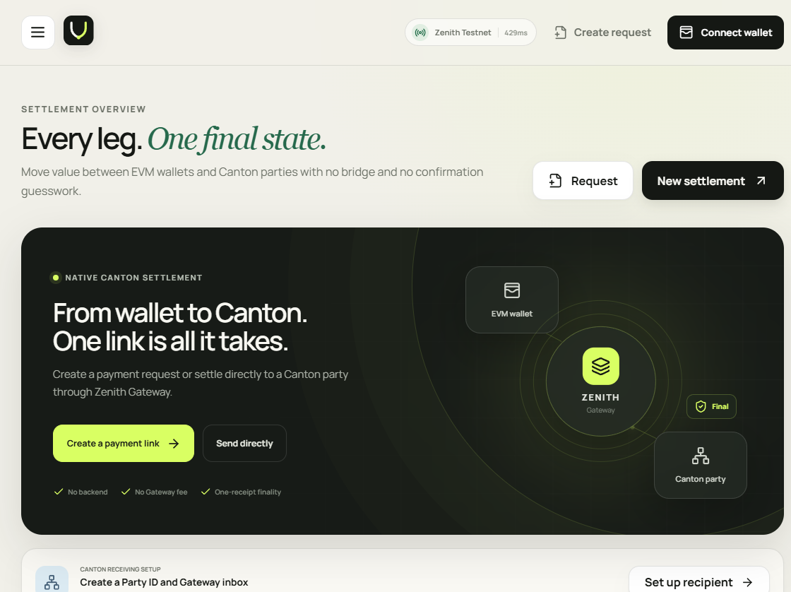
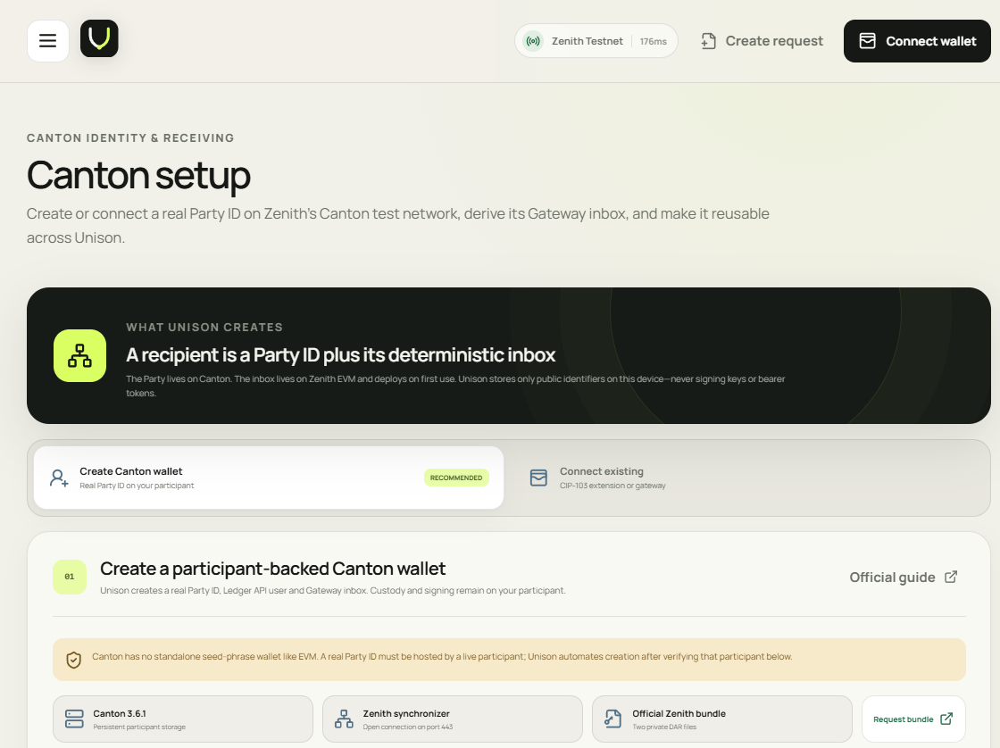
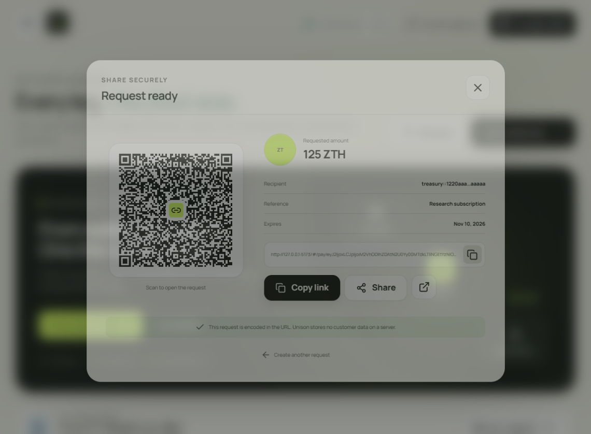

<div align="center">
  

# UNISON

### Zenith EVM → Canton settlement desk

Create and pay shareable Canton settlement requests from a standard EVM wallet through Zenith Gateway.


</div>

UNISON is a static, privacy-first React DApp that connects EVM payments with Canton recipients. A recipient creates a payment link or QR code containing a full Canton Party ID; the payer opens it, reviews the destination, and signs the transfer with an EIP-1193-compatible EVM wallet. UNISON resolves the Party ID to its deterministic Zenith Gateway inbox and presents the resulting EVM receipt as settlement proof.

> [!WARNING]
> UNISON currently targets **Zenith Testnet only**. Test assets have no real-world value. Always copy the complete Canton Party ID—funds sent to an inbox derived from an incorrect ID cannot be recovered.



## Why UNISON

- **Native EVM → Canton flow** — resolves `inboxOf(string)` directly from the Zenith Gateway.
- **One-receipt finality** — no additional confirmation or reorg-waiting logic after a successful receipt.
- **Standard wallet support** — connects, adds or switches networks, reads balances, and sends transfers through EIP-1193 and JSON-RPC.
- **No application backend** — request data is encoded in the URL fragment; requests and activity remain in browser storage.
- **Canton-native onboarding** — connect a CIP-103 wallet or provision a Party ID through your own Canton participant.
- **Supported Gateway assets** — ZTH, DORIG, DUSD, and wCC, including standing-acceptance checks where required.
- **Static hosting ready** — relative assets and hash routes work from a GitHub Pages root or subdirectory.

## How it works

1. **Resolve** — a complete Canton Party ID is mapped to its deterministic Gateway inbox.
2. **Settle** — the payer sends ZTH or a registered ERC-20 asset from an EVM wallet.
3. **Finalize** — Zenith finalizes the EVM transaction through Canton consensus.
4. **Verify** — UNISON links the receipt to the Zenith explorer and records the activity locally.

## Quick start

### Requirements

- Node.js 22+
- npm
- An EIP-1193-compatible wallet for payments
- Optional: a Zenith-compatible CIP-103 wallet or Canton 3.6.1 participant for receiving

```bash
git clone https://github.com/doepiccc/UnisonZenithEVMDapp.git
cd UnisonZenithEVMDapp
npm install
npm run dev
```

Open `http://127.0.0.1:5173`. The development server uses a strict port, so startup stops if port `5173` is unavailable.

Run all project checks:

```bash
npm run lint
npm test
npm run build
```

## Using UNISON

### 1. Prepare a Canton recipient

Open **Canton** and choose one setup path:

- **Create Canton wallet** — connect your own JSON Ledger API, verify the Zenith synchronizer, upload the required Zenith DARs, and create a Party ID plus Ledger API user.
- **Connect existing** — connect an installed CIP-103 wallet or your own remote Wallet Gateway, verify its network, and select an allocated Party ID.

UNISON derives the Gateway inbox automatically and stores only public recipient identifiers on the current device.



### 2. Create and share a payment request

Select **Create request**, then choose the recipient, asset, amount, expiry, and optional memo. Share the generated link or QR code. The request is carried entirely inside the URL and requires no server-side customer record.



### 3. Pay the request

1. Open the link and compare the full Party ID with the recipient.
2. Connect an EVM wallet and add or switch to **Zenith EVM Testnet** when prompted.
3. Review the resolved inbox, asset, amount, and acceptance requirement.
4. Confirm the transaction in the wallet.
5. Open the settlement proof in the Zenith explorer after the receipt is finalized.

To send without a link, select **New settlement** and follow the same recipient, asset, and review flow.

## Canton setup notes

Zenith uses a dedicated Canton test network rather than the Global Synchronizer TestNet. A real Party ID must be hosted by a participant; it cannot be safely generated from a browser or public EVM RPC alone.

For the participant-backed path you need:

- Canton `3.6.1` with persistent storage;
- a connection to `https://synchronizer.testnet.zenith.network:443`;
- `zenith-gateway-parties-0.1.0.dar` and `zenith-dev-cc-0.1.1.dar`, available from `partners@zenith.network`.

The DAR files are not included in this repository. UNISON checks their published SHA-256 hashes before upload. A Ledger API bearer token remains in React state and is never written to `localStorage`.

Development proxy routes:

| Route | Target |
| --- | --- |
| `/api/canton` | `http://127.0.0.1:7575` |
| `/api/canton-wallet` | `http://127.0.0.1:3030/api/v0/dapp` |
| `/api/zenith-gateway` | `https://gateway.testnet.zenith.network` |

For static production hosting, use a CIP-103 wallet or configure a trusted HTTPS reverse proxy to your JSON Ledger API. Never send an administrative bearer token through an untrusted CORS proxy.

## Supported assets

| Asset | Origin | Recipient requirement |
| --- | --- | --- |
| ZTH | EVM native | None; arrives on Canton as wZTH |
| DORIG | EVM | None |
| DUSD | Canton | Standing acceptance required |
| wCC | Canton | Standing acceptance required |

The UI reads the current Gateway registry when available and falls back to a bundled testnet snapshot when the registry endpoint cannot be reached from a browser.

## Network configuration

| Parameter | Value |
| --- | --- |
| Network | Zenith EVM Testnet |
| Chain ID | `936485` (`0xe4a25`) |
| RPC | `https://rpc.testnet.zenith.network/` |
| Gateway | `0x00000000000000000000000000000000000a7e00` |
| Explorer | `https://explorer.testnet.zenith.network/` |
| Faucet | `https://explorer.testnet.zenith.network/faucet` |

Canton identity is connected separately on the **Canton** page; Canton is the finality layer and does not expose another EVM chain ID to add to MetaMask.

## Technology and data model

- React 19, TypeScript, Vite, and ethers v6
- Official `@canton-network/dapp-sdk` for CIP-103 connectivity
- WalletConnect client support
- QR payment links via `qrcode.react`
- Vitest unit tests and ESLint checks
- `localStorage` for saved recipients, requests, and activity only
- No private keys, wallet seed phrases, or bearer tokens persisted by UNISON

## Deployment

### GitHub Pages

1. Push the project to the default branch (`master` in this repository).
2. In **Settings → Pages → Build and deployment**, select **GitHub Actions**.
3. The included `.github/workflows/deploy.yml` tests, builds, verifies, and publishes `dist/`.

For a manual Pages build:

```bash
npm ci
npm test
npm run build:pages
```

The build uses relative assets and hash routes, so payment URLs such as `#/pay/...` work without an SPA rewrite.

### Embed in another Pages repository

The included composite action can build UNISON as a submodule and copy it into a parent Pages artifact:

```yaml
- uses: ./apps/unison
  with:
    output-directory: site-dist/unison
```

Check out submodules recursively before this step, then upload `site-dist` as the parent Pages artifact.

## Author and contacts

Developed by **Arseniy Troshin**.

- LinkedIn: [linkedin.com/in/arsenik](https://www.linkedin.com/in/arsenik/)
- Research: [DoEpic.cc — Crypto Currencies Research](https://doepic.cc/)
